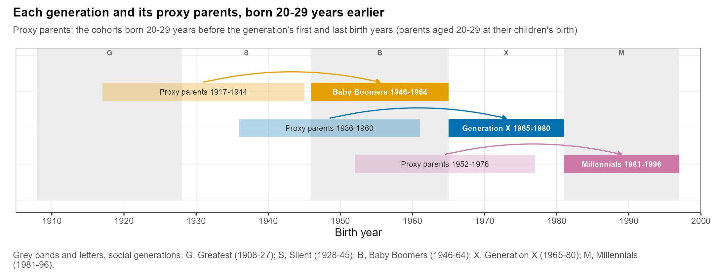
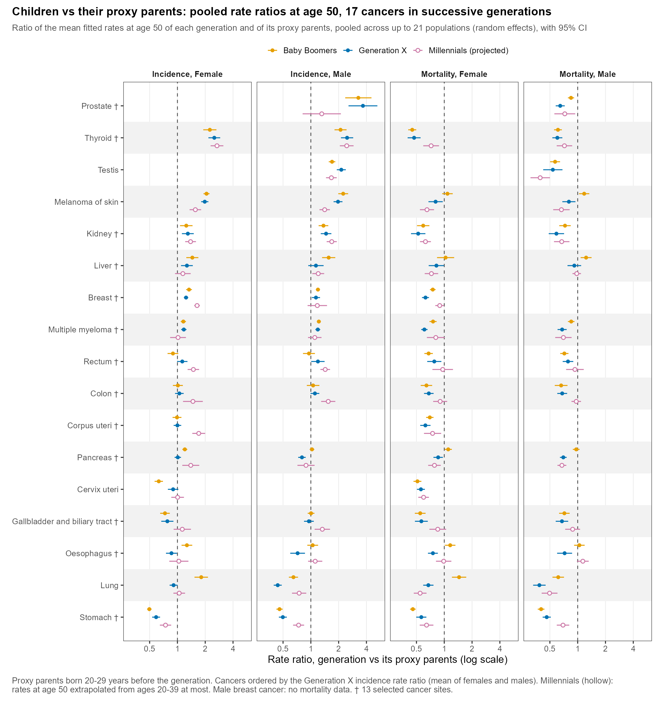
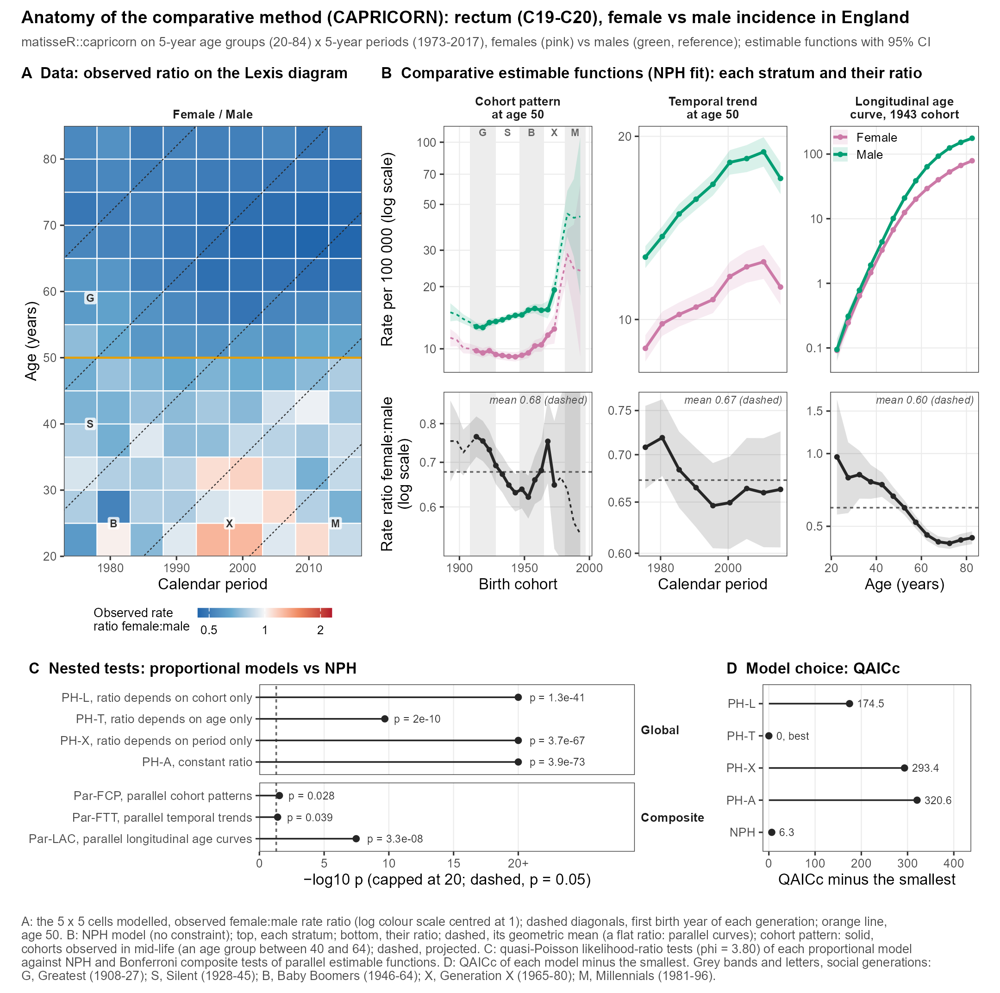

CASE STUDY · MODULES 1 TO 4 · WORK IN PROGRESS

::: {.callout-important title="Preliminary figures"}
The figures on this page are outputs from research in progress. They are shown to teach the methods and may change before publication. Please do not cite or redistribute them.

Some parts of the figures are projected to the reference age (dashed or faded), for example for the Millennials, who were not yet in mid-life when the data end. Projection is not covered in this course: follow the solid, observed parts.
:::

## The project

This project fits age-period-cohort models to cancer incidence and mortality in **21 European populations**: 16 national cancer registries and 5 countries with regional registries. It **replicates for Europe** the study of [Rosenberg and Filho (JAMA Netw Open 2024)](https://doi.org/10.1001/jamanetworkopen.2024.15731), who analysed cancer incidence in successive social generations in the United States.

**The question:** are younger generations (Generation X, Millennials) at higher risk of cancer than their parents' generation was at the same age, and does the answer differ by cancer, sex and country?

| Step | What the project does | Course module |
|---|---|---|
| 1 | Builds Lexis diagrams of cases and person-years by age and period for each population, cancer and sex (5 x 5 cells, ages 20 to 84) | [Module 1](../modules/m1-lexis-rates.qmd) |
| 2 | Fits the New APC model to each diagram and extracts the fitted cohort pattern at age 50 | [Module 2](../modules/m2-new-apc-model.qmd) |
| 3 | Averages the pattern by social generation and contrasts each generation with its proxy parents | [Module 4](../modules/m4-generations-shares.qmd) |
| 4 | Pools the rate ratios across populations by random-effects meta-analysis | [Module 4](../modules/m4-generations-shares.qmd) |
| 5 | Illustrates the comparative method by comparing women with men using CAPRICORN | [Module 3](../modules/m3-capricorn.qmd) |

## Figure 1 · Anatomy of the New APC model

Rectum (C19-C20), incidence in England, women (pink) and men (green).

{fig-alt="Four panels: observed rates on the Lexis diagram, fitted cohort pattern at age 50, local drifts by age, and fitted temporal trend with period deviations, for women and men." width="85%"}

*(A) Observed rates in the 5 x 5 Lexis cells modelled (5-year age groups 20 to 84, 5-year periods 1973 to 2017), log colour scale; dashed diagonals mark the first birth year of each social generation and the orange line marks age 50. (B) Fitted cohort pattern at age 50 with 95% confidence intervals; solid for cohorts observed in mid-life, dashed for projected cohorts. (C) Local drift of each age group; dashed, net drift. (D) Fitted temporal trend at age 50 (solid), the trend from net drift alone (dashed), and period deviations below.*

**What to notice**

- In panel B, how do rates at age 50 change from older to younger cohorts, in women and in men?
- In panel C, at which ages are local drifts highest? How do they compare with the net drift?
- In panel D, how large are the period deviations around the net-drift trend?

*You can reproduce a figure like this yourself in [Module 2](../modules/m2-new-apc-model.qmd).*

## Figure 2 · Generations and their proxy parents

{fig-alt="Timeline showing the Baby Boomers, Generation X and Millennials and their proxy parents, with arrows from proxy parents to the generation." width="95%"}

*Social generations (dark bars; Rosenberg and Filho, JAMA Netw Open 2024) and their proxy parents (light bars), the cohorts born 20 to 29 years before the generation's first and last birth years. Baby Boomers 1946-1964, proxy parents 1917-1944; Generation X 1965-1980, proxy parents 1936-1960; Millennials 1981-1996, proxy parents 1952-1976. Arrows run from the proxy parents to the generation. Grey bands and letters: G, Greatest; S, Silent; B, Baby Boomers; X, Generation X; M, Millennials.*

**In R:** `social_generations()` lists these definitions and `generation_contrasts()` lists the comparisons.

## Figure 3 · Children versus their proxy parents

{fig-alt="Forest plot of pooled rate ratios of each generation versus its proxy parents for 17 cancers, for incidence and mortality, women and men." width="85%"}

*Ratio of the mean fitted rates at age 50 of each generation (Baby Boomers, Generation X, Millennials) to those of its proxy parents, for incidence and mortality in women and men, pooled across up to 21 populations by random-effects meta-analysis, with 95% confidence intervals (log scale). Ratios for the Millennials rely on cohorts projected to age 50, which this course does not cover.*

**What to notice**

- Pick one cancer. Is the incidence ratio above 1 (more disease than the parents' generation had at the same age)?
- Does mortality follow incidence? Why might mortality ratios differ, for example because of screening or treatment?
- Compare women and men.

**In R:** each point is `fcp_contrast()` results from many fits combined with `pool_rr()` (Module 4).

## Figure 4 · Anatomy of the comparative method

Rectum (C19-C20), incidence in England, women vs men.

{fig-alt="Panels: observed female to male rate ratio in each Lexis cell; estimable functions by sex; likelihood-ratio tests of the proportional models; model choice by QAICc." width="85%"}

*(A) Observed female:male rate ratio in each cell; (B) estimable functions by sex; (C) quasi-Poisson likelihood-ratio tests of each proportional model against NPH, with Bonferroni composite tests; (D) QAICc of each model minus the smallest. This analysis allowed for overdispersion (dispersion 3.80).*

*Walk through it in [Module 3](../modules/m3-capricorn.qmd).*

## How the project is organized

The project follows the reproducibility habits you meet in [Module 6](../modules/m6-capstone.qmd):

- **Numbered scripts**, run in order: build the generation data, fit the models, then make the figures and tables.
- **Outputs in one folder per step**, each with a **data dictionary** listing every file and variable.
- **Numbers in reports are read from outputs**, never typed.

The project repository will be linked here once it is public.

<strong>Finished this case study?</strong>
<button type="button" aria-pressed="false">Mark complete</button>

