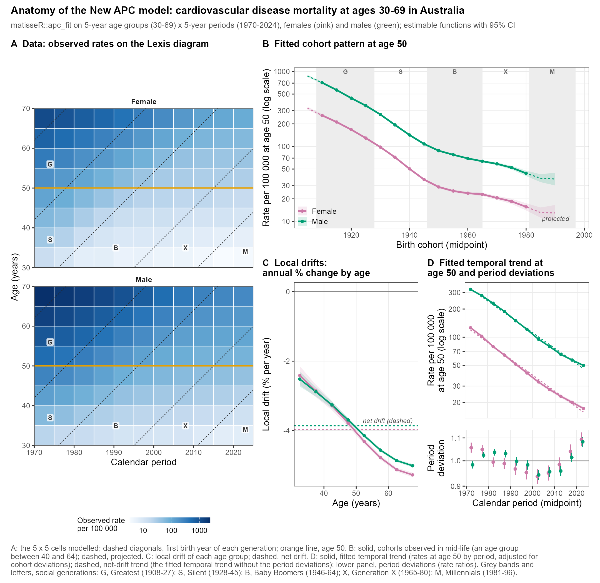

CASE STUDY · MODULES 2 TO 4 · WORK IN PROGRESS

::: {.callout-important title="Not yet published"}
This project is still in progress. The figures on this page are preliminary and are shown only to teach the methods. Dashed or faded parts are projected cohorts; projection is not covered in this course, so follow the solid, observed parts. Please do not cite or redistribute the figures.
:::

## The question

Premature death is death between ages 30 and 70, the age range of the Sustainable Development Goal 3.4 target. The project follows premature deaths from **cardiovascular diseases** and from **cancer** in 13 world areas, using deaths and population by age group and year from the WHO Mortality Database. How do these causes change by **age**, by **calendar period** and by **birth cohort**, and how do generations compare?

The two figures below illustrate the method with one country, Australia, from 1970 to 2024.

## How the project uses matisseR

Each step names the `matisseR` functions and the module that teaches them.

| Step | What the project does | In matisseR | Course module |
|---|---|---|---|
| 1 | Builds a Lexis diagram of deaths and person-years by 5-year age group and year for each area, cause and sex | `rates_make()`, `rates_chunk()` | [Module 1](../modules/m1-lexis-rates.qmd) |
| 2 | Fits the New APC model to each diagram and reads the **net drift** and the **local drifts** by age, comparing early-onset ages (30 to 49) with late-onset ages (50 to 69) | `apc_fit()`, `apc_ef()`, `ld_onset()` | [Module 2](../modules/m2-new-apc-model.qmd) and [Module 4](../modules/m4-generations-shares.qmd) |
| 3 | Reads the fitted **cohort pattern**: the rate at one age for each **birth cohort** | `apc_fcp()` | [Module 2](../modules/m2-new-apc-model.qmd) |
| 4 | Averages the cohort pattern by **social generation**, contrasts each generation with its proxy parents, and pools the ratios across populations | `social_generations()`, `fcp_generations()`, `fcp_contrast()`, `pool_rr()` | [Module 4](../modules/m4-generations-shares.qmd) |
| 5 | Estimates the fitted **cohort share** of cancer and of cardiovascular diseases among all deaths | `fcp_share()` | [Module 4](../modules/m4-generations-shares.qmd) |
| 6 | Tests whether cancer and cardiovascular diseases follow proportional patterns | `capricorn()`, `cap_ef()` | [Module 3](../modules/m3-capricorn.qmd) |

## Figure 1 · Anatomy of the New APC model

Cardiovascular disease mortality at ages 30 to 69 in Australia, females (pink) and males (green).

{fig-alt="Four panels: observed death rates on the Lexis diagram, fitted cohort pattern at age 50, local drifts by age, and fitted temporal trend with period deviations, for females and males." width="85%"}

*(A) Observed death rates in the 5 x 5 Lexis cells modelled (5-year age groups 30 to 69, 5-year periods 1970 to 2024), log colour scale; dashed diagonals mark the first birth year of each social generation and the orange line marks age 50. (B) Fitted cohort pattern at age 50, with 95% confidence intervals; solid for cohorts observed in mid-life, dashed for projected cohorts. (C) Local drifts: the annual percent change of each age group, with the net drift dashed. (D) Fitted temporal trend at age 50 (solid), the trend from net drift alone (dashed), and period deviations below. Grey bands: G, Greatest; S, Silent; B, Baby Boomers; X, Generation X; M, Millennials.*

**What to notice**

- In panel B, how do rates at age 50 change from the oldest to the youngest observed cohorts? Does the fall have the same speed in all generations?
- In panel C, at which ages is the annual fall steepest? How does each age compare with the net drift?
- In panel D, how large are the period deviations around the net-drift trend?

*You can reproduce a figure like this yourself in [Module 2](../modules/m2-new-apc-model.qmd); the generation bands come from [Module 4](../modules/m4-generations-shares.qmd).*

## Figure 2 · Anatomy of the comparative method

Cancer against cardiovascular disease (reference) mortality at ages 30 to 69, females, Australia.

{fig-alt="Panels: observed cancer to cardiovascular disease rate ratio in each Lexis cell; estimable functions of each cause and their ratio; likelihood-ratio tests of the proportional models; model choice by QAICc." width="85%"}

*(A) Observed cancer:cardiovascular disease rate ratio in each 5 x 5 cell (blue: cancer higher; orange: cardiovascular disease higher). (B) Estimable functions of each cause under the unconstrained model (NPH), and their ratio (bottom, with its geometric mean dashed): cohort pattern and temporal trend at age 50, and the longitudinal age curve of the 1950 cohort. (C) Likelihood-ratio tests of each proportional model against NPH. (D) QAICc of each model minus the smallest.*

**What to notice**

- In panel A, where are the cells in which cardiovascular disease is higher than cancer? Which birth cohorts do they follow?
- In the bottom left of panel B, from which cohort on is the cancer:CVD ratio above 1?
- In panel D, which model has the smallest QAICc? Which proportional model comes closest, and what does it say about the ratio?

*Walk through the same steps in [Module 3](../modules/m3-capricorn.qmd).*
