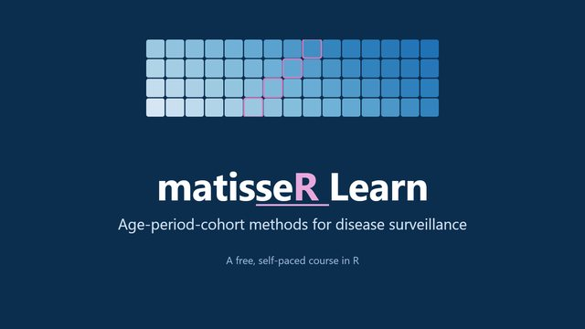
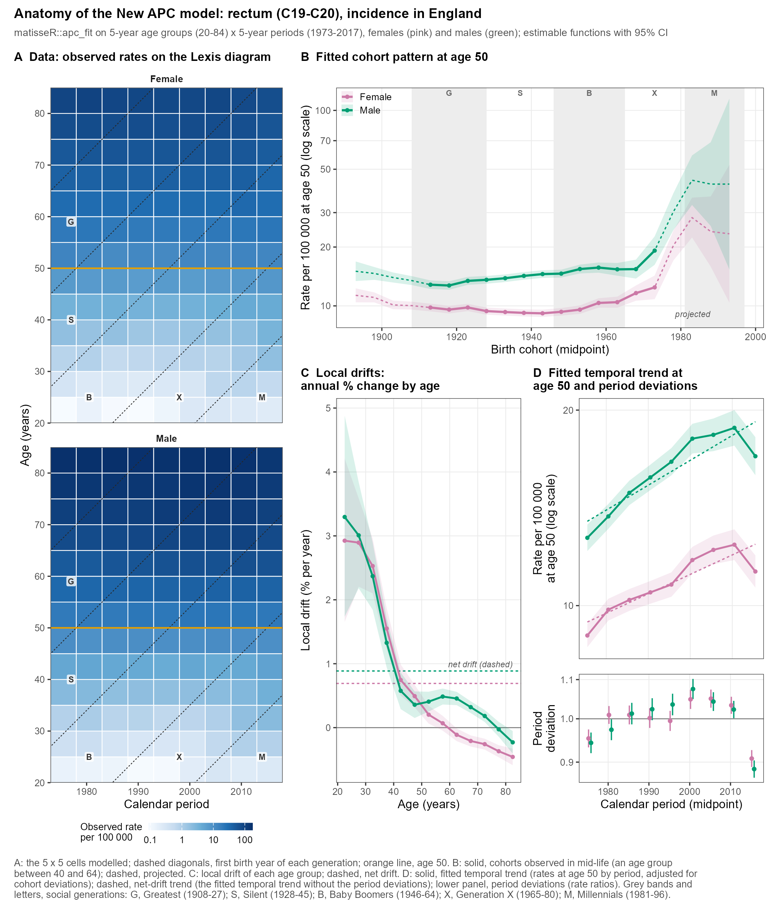
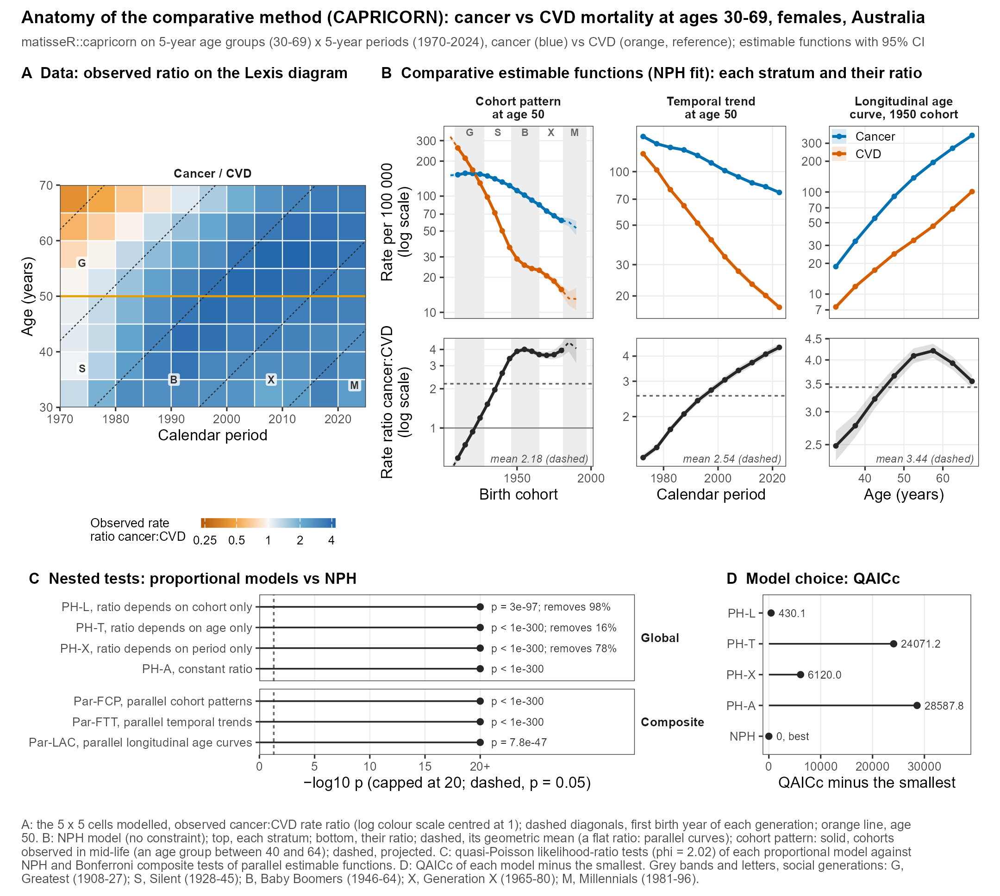

::: {.hero}

COURSE · AGE-PERIOD-COHORT ANALYSIS IN R

<h1>Learn age-period-cohort analysis with matisseR</h1>

A hands-on course on matisseR, an R toolbox for disease surveillance. Fit the New APC model, compare populations, follow social generations, and read figures from two real research projects. All in R, step by step.

Course in development: Modules 0 to 6 are ready to read and run, with short video lessons for the first modules. More will follow.

<a class="btn-course" href="modules/m0-welcome.html">Start Module 0 →</a>
<a class="btn-course alt" href="#syllabus">See the syllabus</a>

For epidemiologists, surveillance and registry researchers, and biostatisticians. Free, self-paced.

<!--yt:hero-->
<a class="course-video-card" href="https://www.youtube.com/watch?v=_crEkLp8MLg" data-yt="_crEkLp8MLg" data-title="Welcome to matisseR Learn" target="_blank" rel="noopener" aria-label="Play Welcome to matisseR Learn, 3:12, on YouTube">▶3:12<strong>Welcome to matisseR Learn</strong>Watch the 3-minute tour of the course ↗</a>
<!--/yt:hero-->
:::

::: {.facts}

Level<b>Beginner to advanced</b>

Time<b>About 11 hours, self-paced</b>

Format<b>Reading, code labs, case studies</b>

Prerequisites<b>Basic R and rates</b>

Software<b>R 4.1+ and matisseR (free)</b>

:::

## What you will learn

<ul class="outcomes">
<li>Organize cases and person-years into Lexis diagrams and <code>rates</code> objects.</li>
<li>Fit the New APC model and read its estimable functions and net drift.</li>
<li>Test whether two or more groups share the same age, period and cohort patterns (CAPRICORN).</li>
<li>Compare social generations with their proxy parents and pool results across populations.</li>
<li>Estimate the fitted cohort share of a cause among all deaths or cases.</li>
<li>Structure an analysis so that others can rerun and check it.</li>
</ul>

<ul class="skills" aria-label="Skills you will gain">
<li>Age-period-cohort analysis</li><li>Lexis diagrams</li><li>Rate ratios</li><li>Comparative analysis</li><li>Social generations</li><li>Disease surveillance</li><li>Reproducible R workflows</li>
</ul>

## Syllabus {#syllabus}

Seven modules, each with readings, hands-on code, a case-study figure to read, and a short self-check. Open a module to see its lessons.

0 of 7 modules complete (saved in this browser)<i></i>

0<strong>Welcome and setup</strong>Install R and matisseR, and check that everything runs.5 lessons · ~30 min+

<ul class="lessons">
<li>Video<a href="https://www.youtube.com/watch?v=_crEkLp8MLg" target="_blank" rel="noopener">Welcome to matisseR Learn</a>3 min</li><!--yt-li:welcome-->
<li>Video<a href="https://www.youtube.com/watch?v=CNYMl7LkbSc" target="_blank" rel="noopener">Install matisseR and run your first example</a>1 min</li><!--yt-li:module0-->
<li>ReadingSet up R and matisseR10 min</li>
<li>LabCheck your setup10 min</li>
<li>Self-check2 questions3 min</li>
</ul>
<a class="go" href="modules/m0-welcome.html">Open Module 0 →</a>

1<strong>Lexis diagrams and rates objects</strong>Organize cases and person-years by age, period and cohort.6 lessons · ~1.5 h+

<ul class="lessons">
<li>ReadingThe Lexis diagram15 min</li>
<li>LabRates objects20 min</li>
<li>LabPrepare rates for modelling: chunk, fill, interpolate25 min</li>
<li>Video<a href="https://www.youtube.com/watch?v=6qpUHUpReXo" target="_blank" rel="noopener">Use your own data in matisseR</a>1 min</li><!--yt-li:owndata-->
<li>LabBring your own data25 min</li>
<li>Self-check3 questions5 min</li>
</ul>
<a class="go" href="modules/m1-lexis-rates.html">Open Module 1 →</a>

2<strong>The New APC model</strong>Fit the model and read its estimable functions.7 lessons · ~2 h+

<ul class="lessons">
<li>ReadingWhy APC is hard: identification and net drift15 min</li>
<li>LabFit the model25 min</li>
<li>LabEstimable functions: LAC, CAC, FTT, FCP, local drifts
<li>Video<a href="https://www.youtube.com/watch?v=iQy6Y7yb0ZQ" target="_blank" rel="noopener">Local drift vs net drift</a>1 min</li><!--yt-li:drift-->
<li>Video<a href="https://www.youtube.com/watch?v=xs3pfK9r_po" target="_blank" rel="noopener">Observed cohorts only</a>1 min</li><!--yt-li:observed-->40 min</li>
<li>Case studyRead a real APC figure20 min</li>
<li>Self-check3 questions5 min</li>
</ul>
<a class="go" href="modules/m2-new-apc-model.html">Open Module 2 →</a>

3<strong>Comparing populations with CAPRICORN</strong>Test whether groups share the same patterns.5 lessons · ~2 h+

<ul class="lessons">
<li>ReadingWhat "proportional" means20 min</li>
<li>LabFit and test the five models35 min</li>
<li>LabCompare estimable functions and rate ratios25 min</li>
<li>Case studyRead the anatomy of CAPRICORN20 min</li>
<li>Self-check3 questions5 min</li>
</ul>
<a class="go" href="modules/m3-capricorn.html">Open Module 3 →</a>

4<strong>Social generations and birth cohort</strong>Compare generations, pool across populations, track a cause's share.7 lessons · ~2 h+

<ul class="lessons">
<li>ReadingSocial generations and proxy parents15 min</li>
<li>LabCompare generations30 min</li>
<li>LabEarly- and late-onset local drifts10 min</li>
<li>LabPool rate ratios across populations20 min</li>
<li>LabFitted cohort shares25 min</li>
<li>Case studyRead real generation figures25 min</li>
<li>Self-check3 questions5 min</li>
</ul>
<a class="go" href="modules/m4-generations-shares.html">Open Module 4 →</a>

5<strong>Methods that are still MATLAB-only</strong>Smoothing, SAGE, EPIPHANY, joinpoint and the standard plots.4 lessons · ~45 min+

<ul class="lessons">
<li>ReadingWhat is not in R yet20 min</li>
<li>ReadingChoose a tool10 min</li>
<li>LabTry one in MATLAB Online15 min</li>
<li>Self-check2 questions3 min</li>
</ul>
<a class="go" href="modules/m5-matlab-methods.html">Open Module 5 →</a>

6<strong>Capstone: your own analysis</strong>Plan, run and document a reproducible APC analysis of your data.5 lessons · ~2 h+

<ul class="lessons">
<li>ReadingPlan your question15 min</li>
<li>LabPrepare your data30 min</li>
<li>LabAnalyse45 min</li>
<li>ReadingMake it reproducible20 min</li>
<li>Self-assessmentChecklist and 1 question10 min</li>
</ul>
<a class="go" href="modules/m6-capstone.html">Open Module 6 →</a>

## Learn from two real projects

Modules 2 to 4 show figures from real research projects built with `matisseR`. Read them as a learner, then run the same ideas on the synthetic example data.

<a class="case" href="cases/eu-generations.html">

<strong>Cancer in successive generations in Europe</strong>Are younger generations at higher risk of cancer than their parents' generation? 21 European populations and 17 cancers.<em>Open case study →</em>
</a>
<a class="case" href="cases/premature-mortality.html">

<strong>Premature mortality across world regions</strong>How do cancer and cardiovascular disease mortality at ages 30 to 69 compare by age, period and birth cohort? Work in progress.<em>Open case study →</em>
</a>

## Live workshop

A live workshop will use this course as its guide. Attendees work through selected modules with the team and ask questions. The format and dates will be announced on the [Live workshop](workshop.qmd) page.

## Team

<ul class="team">
<li>Philip S. Rosenberg</li>
<li>Hyuna Sung</li>
<li>Kieran Kelly</li>
<li>Chenxi Jiang</li>
<li>Adalberto M. Filho</li>
<li>Yasmmin Martins</li>
</ul>

Philip S. Rosenberg, PhD, developed the MATISSE toolbox and its methods. The R package `matisseR` is a port of that toolbox with additions. The team above develops the course.

## FAQ {#faq}

<strong>Do I need to know R already?</strong>+

Basic R helps: running code, reading a table, drawing a plot with ggplot2. Module 0 gets you set up, and every code sample runs as written. You do not need any APC background.

<strong>Do I have to pay for anything?</strong>+

No. R, RStudio and matisseR are free. The MATLAB toolbox in Module 5 needs MATLAB, but you can use MATLAB Online in your browser with a MathWorks account; check MathWorks's current access terms.

<strong>Is the real data in the case studies available?</strong>+

The code samples use synthetic datasets that ship with the package, so you can run everything yourself. The case-study figures come from research in progress, and their data come from public sources such as the WHO Mortality Database and European cancer registries.

<strong>Is matisseR peer reviewed or published?</strong>+

The methods are published; see the <a href="resources.html#papers">method papers</a>. The R package is version 0.1.0 and is being developed. It has an internal test suite, and its comparison with the MATLAB toolbox is in preparation.

<strong>How do I ask a question?</strong>+

Write to <a href="mailto:matisse.apc@gmail.com">matisse.apc@gmail.com</a>. Every function also has a help page in R, for example <code>?apc_fit</code>.

::: {.callout-note title="Questions?"}
Have a question? Send us an email at <a href="mailto:matisse.apc@gmail.com">matisse.apc@gmail.com</a>.
:::
