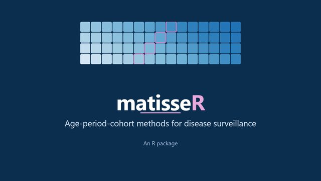
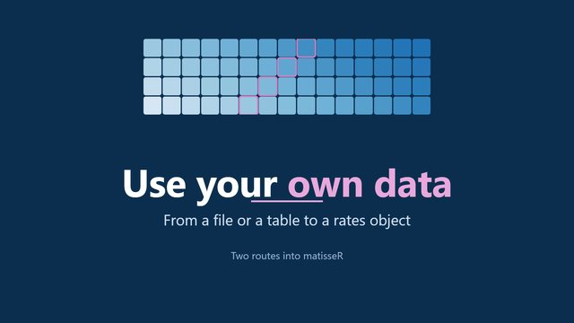
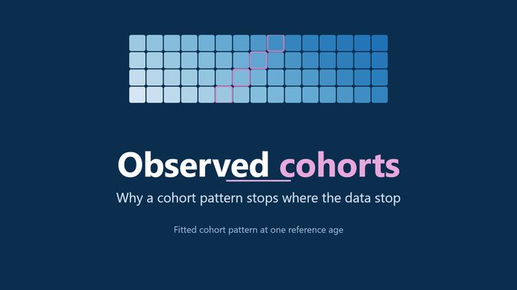
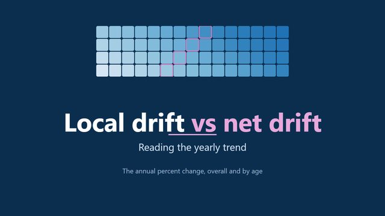

```{r}
#| include: false
source("assets/setup.R")
```

<ul class="lesson-index">
<li><a href="#install">Install</a></li>
<li><a href="#functions">Function reference</a></li>
<li><a href="#datasets">Example datasets</a></li>
<li><a href="#videos">Videos</a></li>
<li><a href="#slides">Slides and data preparation</a></li>
<li><a href="#papers">Method papers</a></li>
<li><a href="#glossary">Glossary</a></li>
<li><a href="#cite">How to cite</a></li>
</ul>

## Install {#install}

Requires R 4.1 or later. `matisseR` depends only on `data.table`; the other packages are for plotting.

```r
install.packages(c("data.table", "ggplot2", "patchwork", "scales", "remotes"))
remotes::install_github("filhoalm/matisseR")
```

The package source, issue tracker and README are at [github.com/filhoalm/matisseR](https://github.com/filhoalm/matisseR). Every function has a help page: for example `?apc_fit`.

## Function reference {#functions}

The main functions, by the module that teaches them.

| Function | What it does | Module |
|---|---|---|
| `matisse_example()` | Index and data of the eight synthetic example datasets | [0](modules/m0-welcome.qmd), [1](modules/m1-lexis-rates.qmd) |
| `csv2rates()`, `rates2csv()` | Read and write the NCI Age Period Cohort Web Tool CSV format | [1](modules/m1-lexis-rates.qmd) |
| `rates_make()` | Build a rates object from a table of cases and person-years | [1](modules/m1-lexis-rates.qmd) |
| `rates_long()`, `rates_uni()` | A table with one row per Lexis cell; a one-line summary | [1](modules/m1-lexis-rates.qmd) |
| `rates_chunk()` | Combine ages and periods into larger cells | [1](modules/m1-lexis-rates.qmd) |
| `rates_fill()` | Replace zero or missing events with a small positive value | [1](modules/m1-lexis-rates.qmd) |
| `rates_i5()`, `pchip()` | Interpolate 5-year age groups to single years; shape-preserving interpolation | [1](modules/m1-lexis-rates.qmd) |
| `lexis_plot()` | Lexis diagram: age by period beside age by cohort | [1](modules/m1-lexis-rates.qmd) |
| `apc_design()` | The age-period-cohort design matrix | [2](modules/m2-new-apc-model.qmd) |
| `apc_fit()` | Fit the New APC model (weighted least squares or Poisson) | [2](modules/m2-new-apc-model.qmd) |
| `apc_ef()`, `apc_efs()` | One or several estimable functions with 95% confidence limits | [2](modules/m2-new-apc-model.qmd) |
| `apc_ref()`, `apc_scale()`, `apc_contrast()`, `apc_ef_vcov()` | Reference cells, scales, contrasts and covariance of an estimable function | [2](modules/m2-new-apc-model.qmd) |
| `capricorn()` | Comparative APC analysis: five models, tests and AICc | [3](modules/m3-capricorn.qmd) |
| `cap_ef()` | Estimable functions and rate ratios by group | [3](modules/m3-capricorn.qmd) |
| `cap_map()`, `cap_fit()`, `cap_blocks()` | Building blocks of the comparative models | [3](modules/m3-capricorn.qmd) |
| `social_generations()`, `generation_contrasts()` | Generations, proxy parents and the contrasts between them | [4](modules/m4-generations-shares.qmd) |
| `apc_fcp()` | Fitted cohort pattern at any reference age | [4](modules/m4-generations-shares.qmd) |
| `fcp_generations()`, `fcp_contrast()` | Mean fitted rate by generation; rate ratios between generations | [4](modules/m4-generations-shares.qmd) |
| `fcp_sum()` | Sum cohort patterns (for example, sites combined) | [4](modules/m4-generations-shares.qmd) |
| `ld_onset()` | Local drifts of early- and late-onset ages | [4](modules/m4-generations-shares.qmd) |
| `pool_rr()` | Random-effects pooling of rate ratios | [4](modules/m4-generations-shares.qmd) |
| `rates_share()`, `fcp_share()` | A cause as a share of all-cause events; fitted cohort share | [4](modules/m4-generations-shares.qmd) |

The generation and share functions go beyond the MATLAB toolbox. See [Module 5](modules/m5-matlab-methods.qmd) for the MATLAB methods that are not yet in R.

## Example datasets {#datasets}

Eight synthetic Lexis diagrams: single years of age 35 to 84 by calendar years 1991 to 2019, with Poisson counts drawn from known age-period-cohort surfaces shaped like common cancer patterns. They are **not registry data**, and they are free to use under the package's MIT license. In R, call `matisse_example(i)`; here are the CSV files (NCI web tool format) for any other software.

```{r}
#| echo: false
#| results: asis
idx <- matisse_example()
tab <- idx[, .(Dataset = sprintf("[%s](data/%s)", file, file), Site = site, Sex = sex, Population = population,
               Cases = format(cases, big.mark = ","), `Zero cells` = zero_cells,
               `True net drift (%/yr)` = fifelse(is.na(net_drift), "-", format(round(net_drift, 2), nsmall = 2)),
               Design = design)]
cat(knitr::kable(tab, format = "pipe"), sep = "\n")
```

<!--yt:library-->
## Videos {#videos}

Short videos with synthetic example data, on the [matisseR Learn YouTube channel](https://www.youtube.com/@matisseRLearn). Click a card to play it here; no data are sent to YouTube until you do.

<div class="video-grid">
<a class="course-video-card" href="https://www.youtube.com/watch?v=yYyNImLYcQY" data-yt="yYyNImLYcQY" data-title="matisseR in one minute" target="_blank" rel="noopener" aria-label="Play matisseR in one minute, 0:53, on YouTube"><span class="course-video-preview"><span class="course-video-play" aria-hidden="true">▶</span><span class="course-video-duration">0:53</span></span><span class="course-video-caption"><strong>matisseR in one minute</strong><span>Lexis diagrams, the New APC model, CAPRICORN and social generations ↗</span></span></a>

<a class="course-video-card" href="https://www.youtube.com/watch?v=_crEkLp8MLg" data-yt="_crEkLp8MLg" data-title="Welcome to matisseR Learn" target="_blank" rel="noopener" aria-label="Play Welcome to matisseR Learn, 3:12, on YouTube"><span class="course-video-preview"><span class="course-video-play" aria-hidden="true">▶</span><span class="course-video-duration">3:12</span></span><span class="course-video-caption"><strong>Welcome to matisseR Learn</strong><span>Watch the 3-minute tour of the course ↗</span></span></a>

<a class="course-video-card" href="https://www.youtube.com/watch?v=CNYMl7LkbSc" data-yt="CNYMl7LkbSc" data-title="Install matisseR and run your first example" target="_blank" rel="noopener" aria-label="Play Install matisseR and run your first example, 1:08, on YouTube"><span class="course-video-preview"><span class="course-video-play" aria-hidden="true">▶</span><span class="course-video-duration">1:08</span></span><span class="course-video-caption"><strong>Install matisseR and run your first example</strong><span>Module 0 in one minute ↗</span></span></a>

<a class="course-video-card" href="https://www.youtube.com/watch?v=6qpUHUpReXo" data-yt="6qpUHUpReXo" data-title="Use your own data in matisseR" target="_blank" rel="noopener" aria-label="Play Use your own data in matisseR, 1:15, on YouTube"><span class="course-video-preview"><span class="course-video-play" aria-hidden="true">▶</span><span class="course-video-duration">1:15</span></span><span class="course-video-caption"><strong>Use your own data in matisseR</strong><span>From a web tool file or your own table to a rates object ↗</span></span></a>

<a class="course-video-card" href="https://www.youtube.com/watch?v=xs3pfK9r_po" data-yt="xs3pfK9r_po" data-title="Observed cohorts only" target="_blank" rel="noopener" aria-label="Play Observed cohorts only, 0:47, on YouTube"><span class="course-video-preview"><span class="course-video-play" aria-hidden="true">▶</span><span class="course-video-duration">0:47</span></span><span class="course-video-caption"><strong>Observed cohorts only</strong><span>Why a cohort pattern stops where the data stop ↗</span></span></a>

<a class="course-video-card" href="https://www.youtube.com/watch?v=iQy6Y7yb0ZQ" data-yt="iQy6Y7yb0ZQ" data-title="Local drift vs net drift" target="_blank" rel="noopener" aria-label="Play Local drift vs net drift, 1:16, on YouTube"><span class="course-video-preview"><span class="course-video-play" aria-hidden="true">▶</span><span class="course-video-duration">1:16</span></span><span class="course-video-caption"><strong>Local drift vs net drift</strong><span>How to read the yearly trend by age ↗</span></span></a>
</div>
<!--/yt:library-->

## Slides and data preparation {#slides}

Course slides, and the steps to prepare registry data for the NCI web tool (which `csv2rates()` reads directly).

| File | Description | Size |
|---|---|---|
| [SEER_CI5plus_to_APC_WebTool.pptx](downloads/SEER_CI5plus_to_APC_WebTool.pptx) | From SEER\*Stat or the CI5 Plus database to the APC input matrix, and the rules the web tool enforces | 1.8 MB |
| [Statistical_Methods_in_CSR.pptx](downloads/Statistical_Methods_in_CSR.pptx) | Statistical methods in cancer surveillance research: why these methods are needed | 1.0 MB |
| [The_Lexis_Diagram.pptx](downloads/The_Lexis_Diagram.pptx) | The Lexis diagram, its axes, and comparing several diagrams | 3.1 MB |

The [NCI Age Period Cohort Analysis Web Tool](https://analysistools.cancer.gov/apc/) runs the standard analysis in a browser. Its rules include equal age and period interval widths (5-year ages need 5-year periods) and no zero count or population cells.

## Method papers {#papers}

- [Advances in statistical methods for cancer surveillance research: an age-period-cohort perspective](https://www.frontiersin.org/journals/oncology/articles/10.3389/fonc.2023.1332429/full) (Front Oncol 2024; [PDF](downloads/Filho_Rosenberg_2024_FrontOncol.pdf)). The overview of the methods.
- [The new age-period-cohort model](https://journals.sagepub.com/doi/10.1177/0962280218801121) (Stat Methods Med Res). Module 2.
- [Comparative age-period-cohort analysis](https://link.springer.com/article/10.1186/s12874-023-02039-8) (BMC Med Res Methodol 2023; [PDF](downloads/Rosenberg_2023_BMCMedResMethodol.pdf)). CAPRICORN and EPIPHANY; Module 3.
- [Cancer incidence trends in successive social generations in the US](https://jamanetwork.com/journals/jamanetworkopen/fullarticle/2819747) (JAMA Netw Open 2024). Generations, proxy parents and SAGE; Module 4.
- [Smoothing methods for Lexis diagrams](https://journals.sagepub.com/doi/10.1177/09622802231192950). SIFT; Module 5.
- [A web tool for age-period-cohort analysis of cancer incidence and mortality rates](https://aacrjournals.org/cebp/article/23/11/2296/14669/A-Web-Tool-for-Age-Period-Cohort-Analysis-of) (Cancer Epidemiol Biomarkers Prev 2014). The NCI web tool.

## Glossary {#glossary}

**Age-period-cohort (APC) analysis**
: Statistical analysis of rates that separates the effects of age, calendar period and birth cohort.

**Birth cohort**
: People born in the same years. In a Lexis diagram, cohort = period - age.

**CAPRICORN**
: Comparative APC analysis: fits several groups together and tests whether their rates are proportional by age, period or cohort.

**Estimable function (EF)**
: A curve built from the model that does not depend on how the unidentifiable linear trend is assigned: LAC, CAC, FTT, FCP and local drifts.

**Fitted cohort pattern (FCP)**
: The model's rate at a reference age for each birth cohort.

**Fitted temporal trend (FTT)**
: The model's rate at a reference age for each calendar period.

**Lexis diagram**
: A grid of age by calendar period, holding events and person-years in each cell.

**Local drift (LD)**
: The annual percent change in the rate at each age.

**Net drift**
: The overall annual percent change in rates; the linear trend that cannot be assigned to period or cohort alone.

**Overdispersion**
: Variation in counts beyond what the Poisson distribution allows. Real counts usually show it; `capricorn(overdispersion = TRUE)` allows for it.

**Person-years (offset)**
: The population time at risk in a cell; the denominator of a rate.

**Proxy parents**
: The cohorts born 20 to 29 years before a generation's first and last birth years.

**Rates object**
: The `matisseR` representation of a Lexis diagram: matrices of events and person-years by age group and period.

**Social generation**
: A broad group of birth cohorts, such as the Baby Boomers (1946 to 1964).

## How to cite {#cite}

If you use the methods, cite the overview paper and the paper for the method you used:

- Filho A, Rosenberg PS. Advances in statistical methods for cancer surveillance research: an age-period-cohort perspective. *Front Oncol* 2024;13:1332429. [doi:10.3389/fonc.2023.1332429](https://doi.org/10.3389/fonc.2023.1332429)
- Comparative APC (CAPRICORN): Rosenberg PS et al. *BMC Med Res Methodol* 2023 (PMID 37853346).
- Social generations: Rosenberg PS, Filho A. *JAMA Netw Open* 2024. [doi:10.1001/jamanetworkopen.2024.15731](https://doi.org/10.1001/jamanetworkopen.2024.15731)

To cite the software: *matisseR: an R port of the MATISSE toolbox, version 0.1.0.* [github.com/filhoalm/matisseR](https://github.com/filhoalm/matisseR)

Questions? Write to <a href="mailto:matisse.apc@gmail.com">matisse.apc@gmail.com</a>.
